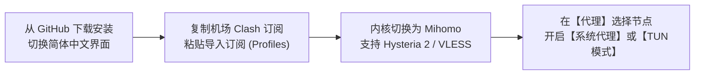

# 🛠️ Clash Verge Rev 教程 (2026最新)：下载安装、订阅配置、TUN模式与常见问题排查

<ArticleHeader :likes="0" :views="0" badge="新手必备" badgeClass="badge-top" category="🛠️ 软件与教程中心" date="2026-08-17" id="clash-verge-guide" tags="Clash Verge Rev, Mihomo内核, TUN模式, 订阅导入, 报错排查"/>

<div class="intro-banner" style="background: var(--vp-c-bg-alt); border: 1px solid var(--vp-c-gutter); border-left: 4px solid #0284c7; padding: 1.1rem 1.35rem; border-radius: 8px; margin-bottom: 1.8rem; font-size: 0.95rem; line-height: 1.7; color: var(--vp-c-text-2);">
  <strong>懂哥机导读：</strong>原 Clash for Windows (CFW) 停止维护后，**Clash Verge Rev** 凭借其基于 Tauri 框架打造的极轻量内存占用、对 Mihomo (Clash Meta) 内核的原生支持以及现代化 UI 界面，已成为目前 Windows 与 macOS 桌面端首选的科学上网客户端。本文提供官方防钓鱼安全下载地址、快速上手配置流程、TUN 虚拟网卡代理与常见报错排查。
</div>

---

## 1. 痛点分析与官方下载避坑

在下载与安装 Clash Verge Rev 时，绝大多数新手面临着极其严峻的**钓鱼镜像站与毒木马风险**：

1. **搜索引擎广告钓鱼站（木马投毒）**：在百度、Bing 搜索“Clash 官网”或“Clash Verge 下载”，首页排名前几位的往往是盗版钓鱼网站。这些打包好的 EXE 安装包被植入了后门程序，专门窃取用户的 Telegram 密钥、火狐/谷歌浏览器密码与加密货币钱包。
2. **系统代理设置失效（软件能上网，终端/UWP 无法翻墙）**：普通代理模式仅能接管浏览器 HTTP 流量，对于 CMD、PowerShell、Git 命令行、Telegram 桌面端及 Windows 商店应用无效。
3. **老旧 Core 不支持新协议**：使用老旧的 Clash Premium 内核，导致机场的 Hysteria 2、VLESS Reality 节点全部报错无响应。

---

## 2. 官方开源安全下载通道

> [!CAUTION]
> **安全铁律**：切勿在任何非 GitHub Release 渠道或百度网盘分享链接下载 Clash 安装包！认准唯一官方开源发布端。

* **GitHub 官方发布仓库**：[clash-verge-rev/clash-verge-rev (Releases 页面 ↗)](https://github.com/clash-verge-rev/clash-verge-rev/releases)
* **官方主仓库**：[clash-verge-rev/clash-verge-rev (GitHub ↗)](https://github.com/clash-verge-rev/clash-verge-rev)

| 操作系统平台 | 安装包文件名格式 | 适用硬件架构与系统 |
| :--- | :--- | :--- |
| **Windows 64位** | `Clash.Verge_x.x.x_x64-setup.exe` | Intel / AMD x86_64 绝大多数电脑（首选） |
| **Windows 64位绿色免安装** | `Clash.Verge_x.x.x_x64_portable.zip` | 免安装便携版，解压即用 |
| **Windows ARM64** | `Clash.Verge_x.x.x_arm64-setup.exe` | 联想 ThinkPad X13s, Surface Pro 等 ARM 设备 |
| **macOS (Apple Silicon)** | `Clash.Verge_x.x.x_aarch64.dmg` | M1 / M2 / M3 / M4 芯片 Mac（首选） |
| **macOS (Intel 芯片)** | `Clash.Verge_x.x.x_x64.dmg` | 2020 年及之前老款 Intel 芯片 Mac |

---

## 3. 保姆级实战配置流程



### 步骤 0：切换为简体中文界面
1. 首次打开软件，若默认显示为英文，点击左侧菜单栏底部的 **`Settings` (设置)**。
2. 找到 **`Language` (语言)** 选项，下拉选择 **`简体中文 (zh-CN)`**，界面即刻完成汉化。

---

### 步骤 1：导入机场 Clash 订阅链接

1. 登录你使用的翻墙机场用户后台（若尚未选定机场，可参考本站 [2026 翻墙机场天梯推荐榜单](/recommend/)），复制 **Clash 订阅链接**。
2. 打开 Clash Verge Rev，点击左侧菜单栏的 **`订阅` (Profiles)**。
3. 在顶部输入框粘贴该订阅链接，点击 **`导入` (Import)**。
4. 导入成功后，鼠标左键点击该配置文件卡片，边框变为高亮激活状态。
5. 建议右键该订阅卡片，设置 **`自动更新间隔 (h)`** 为 **12 小时**，保持节点实时更新。

---

### 步骤 2：切换 Mihomo (Clash Meta) 内核

1. 点击左侧 **`设置` (Settings)**。
2. 找到 **`Clash 内核` (Clash Core)** 项。
3. 将默认内核切换为 **`Mihomo (Clash Meta)`**。
4. 点击右侧的重启图标以重启内核服务。切换后即可原生支持 VLESS Reality、Hysteria 2 和 TUIC 等新协议节点。

---

### 步骤 3：选择节点并测试延迟

1. 点击左侧菜单栏的 **`代理` (Proxies)**。
2. 策略组通常选择 **`Rule` (规则分流模式)**。
3. 在节点列表中，点击右上角的 **雷电/刷新图标** 进行全量节点延迟测速。
4. 选择延迟数字较低、显示绿色的节点（例如香港、日本、新加坡等常用区域）。

---

### 步骤 4：开启系统代理或系统级 TUN 模式

* **日常网页浏览**：在左侧 `设置` 中打开 **`系统代理` (System Proxy)** 开关，右下角任务栏小图标变亮，浏览器即可正常访问外网。
* **游戏、终端命令行与全电脑接管**：
  1. 进入 `设置` -> 打开 **`TUN 模式` (Tun Mode)** 开关。
  2. 首次开启时，软件会弹窗提示安装系统虚拟网卡驱动（服务模式），点击 **授权/安装**。
  3. 安装完成后，将 `堆栈 (Stack)` 设为 **Mixed** 或 **System**。此时全台电脑的所有网络封包（包括 Git、Steam、Telegram 等）将自动无感经过 Clash 代理分流。

---

## 4. 进阶技巧：扩展 Merge 脚本编写

无需手动修改机场订阅文件，通过 Clash Verge Rev 的 `扩展脚本 (Merge Script)` 功能，可以在每次更新订阅时自动注入你自定义的本地节点与路由规则。

点击 `订阅` -> 右键配置文件选择 `编辑脚本`：

```javascript
// Clash Verge Rev 动态 Merge 扩展示例
function main(config) {
  // 1. 注入自定义 AI 专属策略组
  config['proxy-groups'].push({
    name: '🤖 AI 专用通道',
    type: 'select',
    proxies: ['美国-住宅原生01', '新加坡-专线02', 'DIRECT']
  });

  // 2. 在规则列表头部插入强制分流
  config.rules.unshift(
    'DOMAIN-SUFFIX,openai.com,🤖 AI 专用通道',
    'DOMAIN-SUFFIX,anthropic.com,🤖 AI 专用通道',
    'DOMAIN-SUFFIX,claude.ai,🤖 AI 专用通道'
  );

  return config;
}
```

---

## 5. 常见问题排查 (FAQ)

<details class="faq-card" style="border: 1px solid var(--vp-c-gutter); border-radius: 8px; padding: 0.85rem 1.2rem; margin-bottom: 0.85rem; background: var(--vp-c-bg-alt);">
  <summary style="font-weight: 800; cursor: pointer; color: var(--vp-c-text-1);">Q1: 导入订阅后，所有节点测速全红超时 (Timeout) 怎么排查？</summary>
  <div style="margin-top: 0.65rem; font-size: 0.9rem; color: var(--vp-c-text-2); line-height: 1.65;">
    1. <strong>检查电脑系统时间</strong>：这是 80% 节点超时的根本原因！VLESS/VMess/Hysteria2 协议对时间戳校验极严，系统时间误差超过 90 秒就会导致握手全部失败。请在 Windows 设置中点击“立即同步时间”。<br>
    2. <strong>检查内核是否正确</strong>：老旧 Clash Premium 内核不支持 Hysteria 2，请前往【设置 - Clash 内核】切换为 Mihomo。<br>
    3. <strong>检查机场订阅状态</strong>：登录机场后台核对套餐是否已过期或流量耗尽。
  </div>
</details>

<details class="faq-card" style="border: 1px solid var(--vp-c-gutter); border-radius: 8px; padding: 0.85rem 1.2rem; margin-bottom: 0.85rem; background: var(--vp-c-bg-alt);">
  <summary style="font-weight: 800; cursor: pointer; color: var(--vp-c-text-1);">Q2: 软件提示 "Start Core Failed" 内核启动失败怎么解决？</summary>
  <div style="margin-top: 0.65rem; font-size: 0.9rem; color: var(--vp-c-text-2); line-height: 1.65;">
    这通常是因为 7890 代理端口被其它后台软件（如旧版 CFW、v2rayN 或杀毒软件）占用，或配置文件 YAML 语法损坏。请在【设置 - 还原设置】中重置端口，或在任务管理器中强制结束残留的 clash-core 进程后重新启动。
  </div>
</details>

<details class="faq-card" style="border: 1px solid var(--vp-c-gutter); border-radius: 8px; padding: 0.85rem 1.2rem; margin-bottom: 0.85rem; background: var(--vp-c-bg-alt);">
  <summary style="font-weight: 800; cursor: pointer; color: var(--vp-c-text-1);">Q3: 浏览器可以翻墙，但 Telegram、Git 命令行或游戏无法连接？</summary>
  <div style="margin-top: 0.65rem; font-size: 0.9rem; color: var(--vp-c-text-2); line-height: 1.65;">
    普通“系统代理”仅接管系统 HTTP/HTTPS 端口流量，无法接管 TCP/UDP 原始套接字。请在 Clash Verge Rev【设置】中开启 <strong>TUN 模式</strong>（若未安装服务模式需先点击授权安装），即可全网无感接管所有桌面软件的流量。
  </div>
</details>

<details class="faq-card" style="border: 1px solid var(--vp-c-gutter); border-radius: 8px; padding: 0.85rem 1.2rem; margin-bottom: 0.85rem; background: var(--vp-c-bg-alt);">
  <summary style="font-weight: 800; cursor: pointer; color: var(--vp-c-text-1);">Q4: 开启代理后，UWP 应用（如 Windows 应用商店 / Xbox）提示无网络？</summary>
  <div style="margin-top: 0.65rem; font-size: 0.9rem; color: var(--vp-c-text-2); line-height: 1.65;">
    Windows 系统沙箱机制默认禁止 UWP 应用访问本机的 127.0.0.1 代理端口。请在 Clash Verge Rev 的【设置】中点击 <strong>Windows 隔离解除工具 (Enable Loopback)</strong>，勾选对应的 UWP 应用并点击 Save Changes 即可恢复。
  </div>
</details>

<ArticleLikes :initial="0" id="clash-verge-guide" mode="bottom"/>
